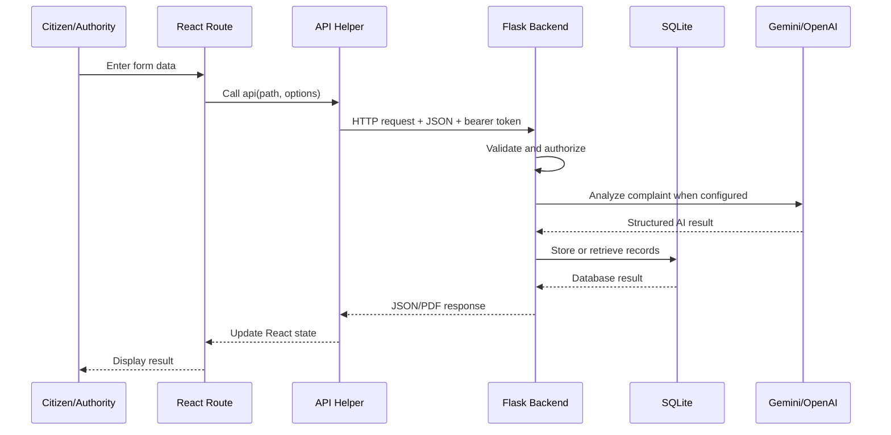
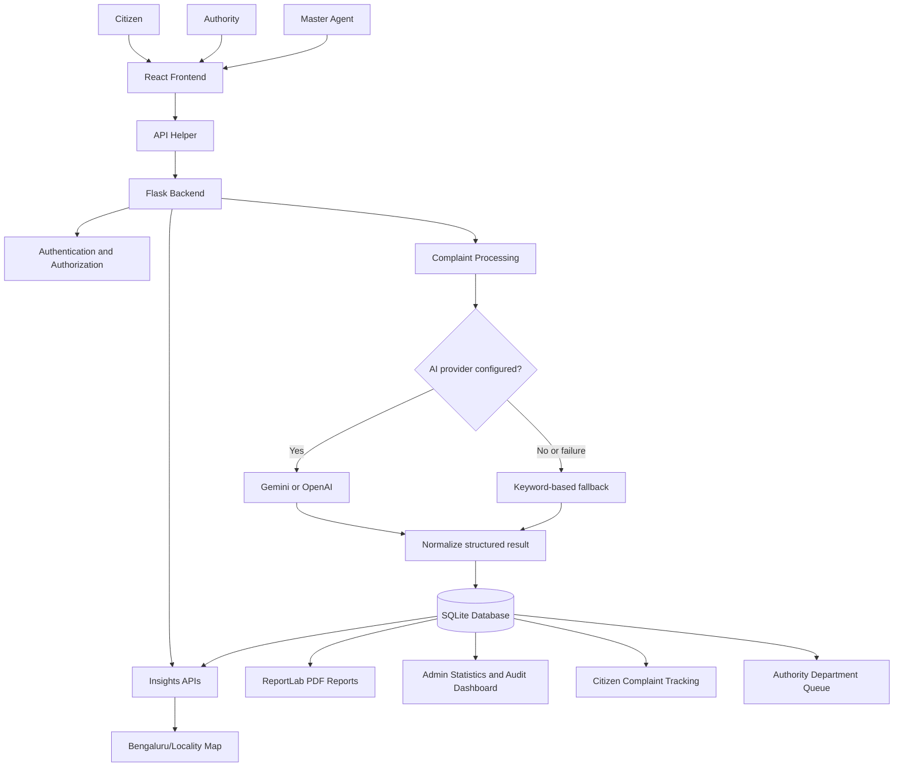
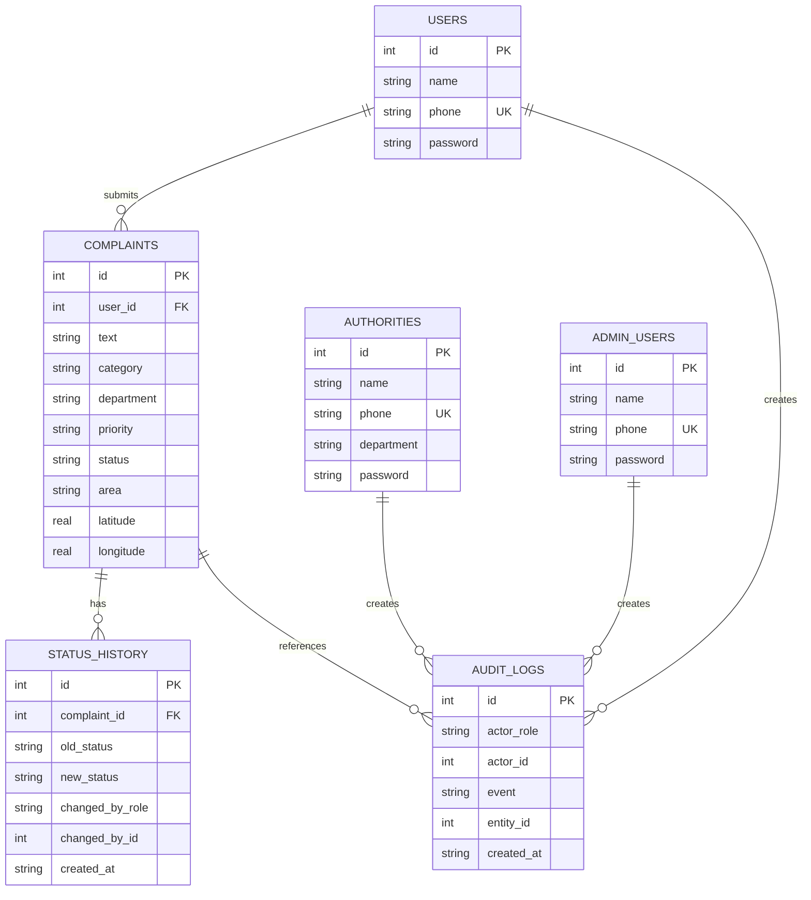
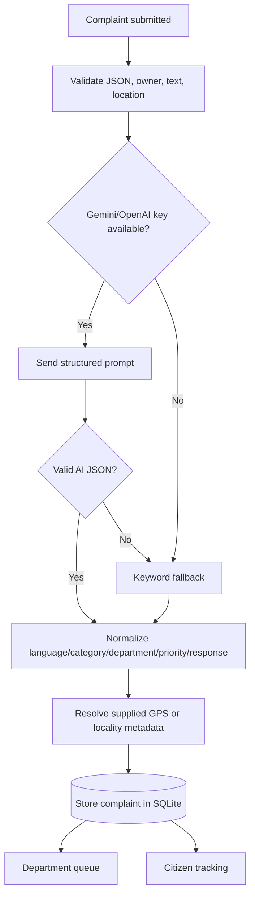
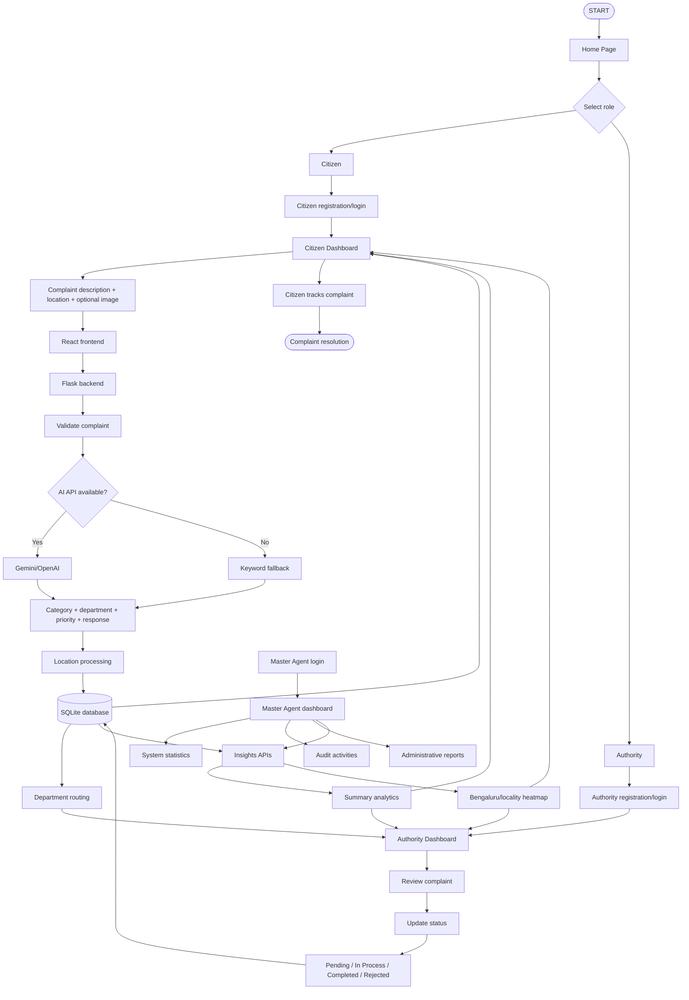

# AI COMPLAINT RESOLUTION SYSTEM
## AI-Based Civic Complaint Management, Intelligent Department Routing and Resolution Tracking Platform

**B.Tech Information Technology Final-Year Project Report**  
**Institution:** Garden City University, Bengaluru  
**Project Context:** KSIT Hackathon  
**Academic Year:** [To be confirmed]  
**Student Name(s):** [To be confirmed]  
**USN/Roll Number(s):** [To be confirmed]  
**Guide:** [To be confirmed]  
**Department:** [To be confirmed]

---

## CERTIFICATE

This is to certify that the project titled **AI Complaint Resolution System** has been carried out by **[Student Name/USN]** under the guidance of **[Guide Name]** in partial fulfillment of the requirements for the Bachelor of Technology degree in Information Technology at Garden City University, Bengaluru.

**Guide Signature:** ____________________  
**Head of Department:** ____________________  
**Date:** ____________________

---

## DECLARATION

I/We declare that this project report titled **AI Complaint Resolution System** is the original work carried out by me/us for the academic requirements of the B.Tech Information Technology programme. The implementation details in this report are based on the supplied project source code and database. Any external references are listed separately.

**Student Signature:** ____________________  
**Date:** ____________________

---

## ACKNOWLEDGEMENT

I/We express sincere gratitude to the project guide, faculty members, department, institution, and hackathon organizers for their guidance and support. I/We also acknowledge the open-source communities and technical documentation that supported the development of the React, Flask, SQLite, mapping, and PDF components used in this project.

---

## ABSTRACT

The AI Complaint Resolution System is a full-stack civic complaint management platform designed to improve the way public complaints are submitted, categorized, routed, monitored, and resolved. Citizens can register, submit complaints with descriptions, locations, optional images, language preference, and optional GPS information. The backend validates and stores each complaint in SQLite and uses an available Gemini or OpenAI language-model API to identify the complaint language, category, responsible department, priority, and initial response. A rule-based fallback is used when an external AI service is unavailable.

Authorities authenticate under a department and receive a department-specific complaint queue. They can review complaints, update statuses, add remarks, and download permitted complaint reports. The system also contains a protected Master Agent module with system statistics, department breakdowns, status analytics, audit activity, complaint search, geographic insights, and administrative PDF reports. The current frontend additionally provides persistent English/Kannada interface switching for citizen and authority pages while preserving stored complaint data and identifiers.

The platform uses React, TanStack Router, Vite, Tailwind CSS, Flask, SQLite, Requests, signed session tokens, password hashing, ReportLab, Leaflet, and React-Leaflet. Its primary distinctive feature is the combination of AI-assisted complaint routing with department-level resolution tracking and Bengaluru-oriented location analytics.

**Keywords:** civic complaints, artificial intelligence, department routing, Flask, React, SQLite, smart city, heatmap analytics, complaint tracking.

---

## TABLE OF CONTENTS

1. Proposed System  
2. Advantages of the Project  
3. Frontend and Backend  
4. System Design  
5. Methodology  
6. Software Requirements Specification  
7. Complete Project Flowchart  
8. Important Source Code Snippets  
9. Plan of Implementation and Development  
10. Conclusion  
11. Future Scope  
12. References  
13. Monthly Progress Report  
14. Limitations and Confirmation Items

---

# 1. PROPOSED SYSTEM

## 1.1 Overview

Traditional civic complaint handling often requires manual sorting, repeated visits, uncertain ownership, and limited visibility into resolution progress. The proposed AI Complaint Resolution System provides a centralized digital workflow in which a citizen submits a complaint once and the system assists with classification, priority assignment, department routing, status tracking, and geographic analysis.

The system has three operational roles:

- **Citizen:** Registers, logs in, submits complaints, views personal complaints, tracks status, and downloads permitted reports.
- **Authority:** Registers under a department, views complaints belonging to that department, updates statuses, adds remarks, and downloads department-permitted reports.
- **Master Agent/Admin:** Uses a protected dashboard to monitor overall citizens, authorities, complaints, activities, status statistics, department performance, stale open complaints, geographic insights, and administrative reports.

## 1.2 Complaint Workflow

1. A citizen creates an account or logs in.
2. The citizen enters a complaint description and location.
3. An optional image, language preference, and GPS position may be supplied.
4. The Flask backend validates the request.
5. The AI integration attempts structured complaint analysis.
6. If AI is unavailable, the keyword-based fallback classifies common categories.
7. The system stores category, department, priority, response, location metadata, and status.
8. The complaint appears in the responsible authority department queue.
9. The authority updates the complaint status.
10. The citizen views the current status and response.
11. The system provides summary, status, area, and map analytics.

## 1.3 Existing System Versus Proposed System

| Aspect | Traditional/Existing Manual Process | Proposed AI Complaint Resolution System |
|---|---|---|
| Complaint submission | Paper, phone, or informal channels | Structured web form |
| Classification | Manual sorting | AI-assisted structured classification |
| Department assignment | Manual forwarding | Automatic department routing |
| Priority | Subjective/manual | AI priority with validated values |
| Tracking | Limited or repeated follow-up | Citizen dashboard and status history |
| Authority work queue | Department-specific manual lists | Protected department dashboard |
| Analytics | Manual summaries | Status, department, area, and map insights |
| Reports | Manual preparation | Permission-checked PDF reports |
| Language interface | Fixed interface language | English/Kannada switching for citizen and authority UI |
| Failure handling | Service unavailable stops workflow | Keyword-based classification fallback |

## 1.4 Location Analytics

The application stores locality and coordinate fields for complaints. The backend exposes heatmap and summary APIs. The frontend displays complaint density using a Bengaluru map component based on Leaflet and React-Leaflet. Existing records may contain Bengaluru localities or campus locations. Records without reliable geographic coordinates should contribute to statistical summaries but should not be represented using fabricated map coordinates.

---

# 2. ADVANTAGES OF THE PROJECT

## 2.1 Automated Complaint Classification

The system sends complaint text to an LLM when a configured Gemini or OpenAI key is available. The response is expected to contain structured category, department, priority, language, and response fields. Backend normalization prevents unsupported categories and priorities from being stored.

## 2.2 Intelligent Department Routing

The predicted category is converted to a responsible department such as Electricity, Water, Garbage, Road, or Fire. This reduces the time required for manual forwarding and presents authorities with a relevant department queue.

## 2.3 Priority Identification

Each complaint receives a Low, Medium, or High priority. This helps authorities distinguish routine issues from urgent cases such as fire or smoke-related complaints.

## 2.4 Reduced Manual Complaint Handling

The system automates registration, complaint storage, classification, department filtering, status history, and reporting. Authorities can update a complaint directly from the dashboard.

## 2.5 Citizen Complaint Tracking

Citizens can view their own complaints, AI responses, category, department, priority, status, location, and report download controls. Ownership checks prevent one citizen from accessing another citizen's reports.

## 2.6 Separate Citizen and Authority Interfaces

The application separates citizen actions from authority operations. Citizens submit and track complaints, while authorities view and update complaints belonging to their department.

## 2.7 Centralized Complaint Management

Complaint information is stored in a central SQLite database with user, authority, complaint, status-history, audit, and admin-account structures.

## 2.8 Department-Wise Monitoring

Authorities are authenticated with a department claim. Backend checks compare the token department with the requested department before returning complaints or accepting status updates.

## 2.9 Geographic Hotspot Visualization

The system aggregates complaint counts by area and returns map points for valid coordinates. Summary responses include total complaints, top areas, and status breakdown.

## 2.10 AI Fallback Mechanism

If an LLM key is absent, a request fails, or the AI response cannot be parsed, the backend uses rule-based fallback analysis. This allows basic demonstrations without depending entirely on an external service.

## 2.11 Transparency and Accessibility

Status history, audit activity, complaint reports, and English/Kannada interface switching improve transparency and usability. Stored complaint content and identifiers remain unchanged when the interface language changes.

## 2.12 Scalability Potential

The backend uses parameterized SQL and role-based endpoint boundaries. The application can later migrate to a production database, stronger deployment infrastructure, multilingual AI services, and mobile clients.

---

# 3. FRONTEND AND BACKEND

## 3.1 Frontend Architecture

The frontend is located in `frontend/helpdesk-harmony-main`. It uses React with TanStack Router and is built using Vite.

| Technology | Purpose in this project |
|---|---|
| React 19 | Component-based user interface and state management |
| TanStack Router | File-based route definitions and navigation |
| Vite | Development server and production bundling |
| Tailwind CSS | Utility-first styling and responsive layouts |
| Radix UI | Reusable accessible UI primitives included in the project |
| React Hook Form | Included form-support dependency; current core authentication forms use React state |
| Zod | Included validation dependency; current shared identity validation uses explicit regular expressions |
| Leaflet | Geographic map engine |
| React-Leaflet | React bindings for map containers, layers, markers, and popups |
| Lucide/Radix ecosystem | Available UI component support |

### 3.1.1 Home/Landing Page

The home route presents the project title, AI-powered description, citizen and authority entry points, and three high-level steps: Submit, AI Routes, and Track. It is implemented in [src/routes/index.tsx](frontend/helpdesk-harmony-main/src/routes/index.tsx).

### 3.1.2 Citizen Registration and Login

Citizen registration collects name, phone, password, and confirmation. Citizen login collects phone and password. Shared validation currently enforces the project identity rules: alphabetic usernames between 3 and 30 characters and exactly 10 numeric phone digits.

### 3.1.3 Citizen Dashboard

The citizen dashboard provides complaint submission, optional image upload, language selection for complaint processing, one-time browser geolocation capture, complaint listing, status display, AI response display, PDF download, and heatmap insight access.

### 3.1.4 Authority Registration and Login

Authority registration collects name, phone, department, password, and confirmation. Authority login requires phone, password, and department. Department values are preserved as API values while their displayed labels can be translated.

### 3.1.5 Authority Dashboard

The authority dashboard loads complaints for the authenticated department, displays complaint text and metadata, permits status changes, displays status feedback, supports report downloads, and shows department heatmap insights.

### 3.1.6 Master Agent Dashboard

The current source contains a protected admin login and dashboard. The dashboard retrieves system statistics, complaint records, audit activities, and geographic insight data. It supports search/filtering, complaint report downloads, system-level PDF reports, and activity display. The Master Agent interface is intentionally not included in the English/Kannada interface switching scope.

### 3.1.7 Bilingual Interface

The current frontend contains a centralized English/Kannada dictionary, context provider, hook, and language selector. The selected language is stored using the `complaint_resolver_language` localStorage key. The language context affects citizen and authority pages, while admin routes remain English-only.

## 3.2 Backend Architecture

The backend is implemented in [app.py](app.py) using:

- Python
- Flask
- Flask-CORS
- SQLite
- Requests
- python-dotenv
- itsdangerous
- Werkzeug password hashing
- ReportLab
- Pillow through the ReportLab installation for geo-stamped image support

The backend loads environment variables, creates a Flask application, configures CORS, initializes SQLite schema migrations, validates requests, issues signed session tokens, and exposes the REST-style HTTP API.

### 3.2.1 API Endpoint Catalogue

| Method | Endpoint | Function |
|---|---|---|
| GET | `/` | Backend status page and endpoint overview |
| GET | `/health` | Health check |
| POST | `/user/register` | Register a citizen |
| POST | `/user/login` | Authenticate a citizen and issue a token |
| POST | `/authority/register` | Register an authority under a department |
| POST | `/authority/login` | Authenticate an authority and issue a department token |
| POST | `/complaint` | Create and classify a complaint |
| GET | `/user/complaints/<user_id>` | Retrieve complaints owned by the authenticated citizen |
| GET | `/authority/complaints/<department>` | Retrieve complaints for an authorized department |
| PUT | `/complaint/status` | Update a complaint status for an authorized authority/admin |
| GET | `/insights/heatmap` | Return complaint density map points |
| GET | `/insights/summary` | Return complaint totals, top areas, and status breakdown |
| POST | `/seed/demo-complaints` | Generate demonstration data; should be restricted in production |
| POST | `/admin/login` | Authenticate the Master Agent |
| GET | `/admin/stats` | Return system-wide counts and breakdowns |
| GET | `/admin/activities` | Return audit activity records |
| GET | `/admin/complaints` | Return system-wide complaints for admin |
| GET | `/admin/report?type=...` | Generate protected admin reports |
| GET | `/complaint/<id>/history` | Return authorized status history |
| GET | `/complaint/<id>/report` | Generate an authorized complaint PDF |

### 3.2.2 API Communication

The frontend uses [src/lib/api.ts](frontend/helpdesk-harmony-main/src/lib/api.ts). The helper adds JSON headers, attaches the stored bearer token, parses JSON responses, and raises an error for non-success responses. Separate helper functions download complaint and admin PDF blobs.

## 3.3 Frontend-Backend Communication



---

# 4. SYSTEM DESIGN

## 4.1 Overall System Architecture



### Architecture Components

- **React Frontend:** Provides role-specific screens, form handling, navigation, map rendering, reports, and language switching.
- **API Helper:** Centralizes HTTP request headers, token attachment, JSON parsing, and PDF download handling.
- **Flask Backend:** Owns validation, authentication, authorization, AI processing, persistence, reports, and analytics.
- **AI Layer:** Attempts Gemini or OpenAI structured analysis and falls back to local rules when unavailable.
- **SQLite Database:** Stores users, authorities, complaints, status history, audit events, and admin accounts.
- **Insights Layer:** Aggregates complaints by area, status, department, user, or authority department.
- **Report Layer:** Produces authorized complaint and administrative PDF files.

## 4.2 System Modules

### 4.2.1 Citizen Module

**Description:** Handles citizen accounts and complaint lifecycle viewing.  
**Purpose:** Allow citizens to submit and track civic complaints.  
**Input:** Name, phone, password, complaint text, location, optional image, language, GPS data.  
**Processing:** Validate account/complaint input, authenticate, classify, store, retrieve owned records.  
**Output:** Account response, complaint record, AI response, status, history, and PDF report.

### 4.2.2 Authority Module

**Description:** Provides department-specific operational queues.  
**Purpose:** Allow authorities to review and update relevant complaints.  
**Input:** Authority credentials, department, status, remarks.  
**Processing:** Validate department and bearer role/department, query matching complaints, store status history.  
**Output:** Department queue, updated status, audit event, report.

### 4.2.3 Master Agent Module

**Description:** Protected administrative monitoring module implemented in `admin.login.tsx` and `admin.dashboard.tsx`.  
**Purpose:** Monitor system-wide activity and performance.  
**Input:** Admin credentials, search/filter values, report type.  
**Processing:** Verify admin token, aggregate statistics, query activities, generate reports.  
**Output:** Summary cards, breakdowns, activities, complaint list, map insights, and admin PDFs.

### 4.2.4 Complaint Management Module

Receives a complaint, validates its owner, analyzes its text, resolves or stores location metadata, creates a pending record, and records initial status history.

### 4.2.5 AI Classification Module

The module requests JSON containing `language`, `category`, `department`, `priority`, and `response`. Results are normalized to permitted values. If an external request fails, fallback rules recognize common words such as light, fire, smoke, road, pothole, water, leakage, and garbage.

### 4.2.6 Department Routing Module

Category-to-department mapping is performed by backend normalization. For example, Electrical maps to Electricity, while Fire maps to Fire. Authorities can retrieve only their permitted department.

### 4.2.7 Database Module

SQLite provides local relational persistence. Existing records are preserved during additive migrations. Parameterized queries are used for application data operations.

### 4.2.8 Location Analytics Module

Location processing stores area, latitude, longitude, altitude, accuracy, CRS, capture timestamp, and optional projected coordinates. Bengaluru reference points support legacy locality-based mapping.

### 4.2.9 Heatmap Visualization Module

`LocationHeatmap.tsx` retrieves heatmap and summary responses. `BengaluruGeoMap.tsx` uses React-Leaflet CircleMarkers, tooltips, popups, and map bounds fitting.

### 4.2.10 Authentication Module

Registration uses Werkzeug password hashing. Login supports legacy plaintext migration on successful login. Signed `itsdangerous` tokens carry role and subject identifiers. Protected endpoints use role checks and ownership/department checks.

## 4.3 Database Design

### Users Table

| Field | Type | Purpose |
|---|---|---|
| `id` | INTEGER PRIMARY KEY | Citizen identifier |
| `name` | TEXT | Citizen name |
| `phone` | TEXT UNIQUE | Citizen login phone |
| `password` | TEXT | Hashed or legacy value upgraded on login |

### Authorities Table

| Field | Type | Purpose |
|---|---|---|
| `id` | INTEGER PRIMARY KEY | Authority identifier |
| `name` | TEXT | Authority name |
| `phone` | TEXT UNIQUE | Authority login phone |
| `department` | TEXT | Assigned department |
| `password` | TEXT | Hashed or legacy value upgraded on login |

### Complaints Table

| Field | Type | Purpose |
|---|---|---|
| `id` | INTEGER PRIMARY KEY | Complaint identifier |
| `user_id` | INTEGER | Foreign key to users |
| `text` | TEXT | Original complaint text |
| `location` | TEXT | User-entered location |
| `image` | TEXT | Original optional image data |
| `category` | TEXT | AI/fallback category |
| `department` | TEXT | Routed department |
| `priority` | TEXT | Low, Medium, or High |
| `response` | TEXT | Initial AI/fallback response |
| `status` | TEXT | Pending, In Process, Completed, or Rejected |
| `area` | TEXT | Locality/area name |
| `latitude` | REAL | Latitude |
| `longitude` | REAL | Longitude |
| `created_at` | TEXT | Creation timestamp |
| `updated_at` | TEXT | Last update timestamp |
| `detected_language` | TEXT | AI-selected language |
| `altitude` | REAL | Optional elevation |
| `projected_x/y/z` | REAL | Optional projected coordinates |
| `coordinate_reference_system` | TEXT | CRS identifier |
| `accuracy` | REAL | GPS accuracy |
| `capture_timestamp` | TEXT | GPS capture time |
| `image_geo_tag` | TEXT | Separate stamped image copy |
| `remarks` | TEXT | Complaint/status remarks |

### Supporting Tables

- `status_history`: Records old status, new status, actor, remarks, and timestamp.
- `audit_logs`: Records event type, actor role/id, entity, details, and timestamp without passwords or tokens.
- `admin_users`: Stores protected Master Agent accounts.

### ER Diagram



---

# 5. METHODOLOGY

## 5.1 Development Method

The source does not establish that a formal Scrum or Agile process was followed. The defensible development sequence is:

1. Identify the civic complaint-management problem.
2. Define citizen and authority workflows.
3. Design a React frontend and Flask API boundary.
4. Define SQLite tables and complaint fields.
5. Implement registration, login, complaint submission, and retrieval.
6. Integrate Gemini/OpenAI analysis with fallback rules.
7. Add department queues and status updates.
8. Add location analytics and Leaflet map visualization.
9. Add authentication, authorization, history, audit, and reports.
10. Add English/Kannada interface switching.
11. Test API flows, security boundaries, migrations, PDF generation, and frontend builds.

## 5.2 AI Complaint Processing Method



### Detailed Steps

1. The frontend sends the original complaint text.
2. The backend checks request shape and authenticated ownership.
3. Complaint text and location are validated.
4. The backend checks configured AI credentials.
5. Gemini or OpenAI receives a structured JSON-only prompt.
6. The model identifies language, category, department, priority, and response.
7. The backend parses and normalizes the response.
8. If the external service fails, fallback keywords provide a safe basic result.
9. Location and optional coordinate metadata are prepared.
10. The complaint and initial status are stored.
11. Status history and audit activity are recorded.
12. The complaint becomes visible to the responsible authority department.

## 5.3 Unique Features

The most distinctive feature is the combination of AI-based routing and operational resolution tracking. Classification is not an isolated prediction: it directly controls the department queue and is followed by status history, authority action, citizen visibility, and location analytics.

Other distinctive features include:

- AI plus local fallback classification.
- Separate citizen, authority, and admin permissions.
- Department-specific complaint queues.
- Bengaluru/campus locality analytics.
- GPS and optional geo-stamped evidence support.
- PDF reports using real database records.
- Persistent English/Kannada interface switching.

---

# 6. SOFTWARE REQUIREMENTS SPECIFICATION

## 6.1 Hardware Requirements

The following are practical development requirements; exact university or deployment specifications were not supplied.

| Resource | Minimum | Recommended | Status |
|---|---|---|---|
| Processor | Dual-core 2 GHz | Modern quad-core processor | General development requirement |
| RAM | 4 GB | 8 GB or more | General development requirement |
| Storage | 5 GB free | 10 GB or more | Dependencies, database, build output |
| Operating system | Windows/Linux/macOS | Windows 10/11 or current Linux | Current development environment is Windows |
| Internet | Required for package installation and optional LLM/map tiles | Stable broadband | Required for external AI and map tiles |
| Browser | Modern Chromium/Firefox/Edge | Current browser | Frontend execution |

## 6.2 Software Requirements

| Software | Use |
|---|---|
| Python | Backend language |
| Flask | HTTP API framework |
| Flask-CORS | Browser-origin access control |
| SQLite | Local relational database |
| Requests | LLM HTTP requests |
| python-dotenv | Environment configuration |
| itsdangerous | Signed expiring session tokens |
| ReportLab | PDF generation |
| React 19 | Frontend interface |
| TanStack Router | Route management |
| Tailwind CSS | Styling |
| Vite | Development/build tooling |
| Radix UI | UI primitives available in frontend |
| React Hook Form | Form dependency available in frontend |
| Zod | Validation dependency available in frontend |
| Gemini/OpenAI API | Optional external complaint analysis |
| VS Code | Development environment |
| Git/GitHub | Source control and collaboration |

## 6.3 Functional Requirements

- Citizens shall register and authenticate.
- Authorities shall register with a supported department and authenticate.
- Citizens shall submit complaint text and location with optional image and GPS data.
- The backend shall validate complaint requests.
- AI or fallback logic shall classify complaints.
- Complaints shall be routed to departments.
- Citizens shall view their own complaints.
- Authorities shall view complaints for their own department.
- Authorities shall update permitted statuses.
- The system shall store status history and audit events.
- The system shall expose summary and heatmap analytics.
- Authorized users shall download complaint PDFs.
- The Master Agent shall view system-level reports and analytics.
- Citizen and authority interfaces shall support English/Kannada switching.

## 6.4 Non-Functional Requirements

| Requirement | Current implementation | Production consideration |
|---|---|---|
| Performance | Local Flask/SQLite application with direct SQL queries | Use a production WSGI server and indexed production database |
| Reliability | AI fallback and database persistence | Add monitoring, retries, backups, and service health alerts |
| Usability | Role-specific dashboards, alerts, map, bilingual UI | Add accessibility audit and user research |
| Security | Password hashing, signed tokens, role checks, ownership checks, CORS | Use strong production secret management, HTTPS, rate limiting, CSRF/session hardening |
| Maintainability | Shared API helper, reusable map/alert/language components | Add automated test suite and API schema documentation |
| Scalability | Modular Flask routes and React routes | Migrate SQLite to PostgreSQL and separate file storage |
| Availability | Local development process | Deploy redundant services and database backups |

---

# 7. COMPLETE PROJECT FLOWCHART



---

# 8. IMPORTANT SOURCE CODE SNIPPETS

## 8.1 Home Page

**File:** `frontend/helpdesk-harmony-main/src/routes/index.tsx`  
**Component:** `Home`

```tsx
export const Route = createFileRoute("/")({
  component: Home,
});

function Home() {
  const { t } = useLanguage();
  return (
    <div className="max-w-5xl mx-auto px-4 py-12 sm:py-20">
      <section className="text-center">
        <span className="crs-badge mb-4">{t("aiPowered")}</span>
        <h1>{t("complaintResolutionSystem")}</h1>
        <p>{t("homeDescription")}</p>
      </section>
      <Link to="/user/login" className="crs-btn">{t("login")}</Link>
      <Link to="/authority/login" className="crs-btn">{t("login")}</Link>
    </div>
  );
}
```

The route registers `/` with TanStack Router. The component uses the language hook for interface text and uses typed links for citizen and authority authentication.

## 8.2 User Login Activity

**File:** `frontend/helpdesk-harmony-main/src/routes/user.login.tsx`  
**Component:** `UserLogin`

```tsx
const data = await api("/user/login", {
  method: "POST",
  body: JSON.stringify(form),
});
const id = data?.user_id ?? data?.id ?? data?.user?.id;
if (!id) throw new Error(t("missingUserId"));
localStorage.setItem("user_id", String(id));
if (data.token) localStorage.setItem("session_token", data.token);
navigate({ to: "/user/dashboard" });
```

The component validates the phone first, posts the unchanged payload shape to `/user/login`, stores the authenticated user ID and bearer token, and navigates to the citizen dashboard.

## 8.3 Authority Login Activity

**File:** `frontend/helpdesk-harmony-main/src/routes/authority.login.tsx`  
**Component:** `AuthorityLogin`

```tsx
const data = await api<{ token?: string }>("/authority/login", {
  method: "POST",
  body: JSON.stringify(form),
});
localStorage.setItem("department", form.department);
if (data.token) localStorage.setItem("session_token", data.token);
navigate({ to: "/authority/dashboard" });
```

The authority login payload includes phone, password, and department. The returned token contains the authority role and department claim used by protected backend endpoints.

## 8.4 Complaint Creation Backend

**File:** `app.py`  
**Function:** `create_complaint`

```python
@app.post("/complaint")
@require_roles("user")
def create_complaint():
    data = request_json()
    missing = validate_required_fields(data, ["user_id", "text"])
    if missing:
        return json_error(f"Missing field: {missing}")

    user_id = int(data["user_id"])
    if int(g.auth.get("id", -1)) != user_id:
        return json_error("Insufficient permissions", 403)

    text = data["text"].strip()
    ai_result = analyze_complaint(text, preferred_language)
    ...
```

The endpoint requires a citizen bearer token, verifies ownership, validates text and coordinates, calls AI/fallback analysis, resolves location, and persists the complaint.

## 8.5 User Dashboard

**File:** `frontend/helpdesk-harmony-main/src/routes/user.dashboard.tsx`  
**Component:** `UserDashboard`

```tsx
const data = await api<Complaint[] | { complaints: Complaint[] }>(
  `/user/complaints/${id}`,
);
const list = Array.isArray(data) ? data : data?.complaints ?? [];
setComplaints(list);
```

The dashboard retrieves the authenticated citizen’s complaint list, displays category, department, priority, response, and status, and embeds `LocationHeatmap` for analytics.

## 8.6 Authority Dashboard

**File:** `frontend/helpdesk-harmony-main/src/routes/authority.dashboard.tsx`  
**Component:** `AuthorityDashboard`

```tsx
const data = await api<Complaint[] | { complaints: Complaint[] }>(
  `/authority/complaints/${dep}`,
);
setComplaints(Array.isArray(data) ? data : data?.complaints ?? []);

await api("/complaint/status", {
  method: "PUT",
  body: JSON.stringify({ complaint_id: id, status }),
});
```

The dashboard loads only the stored department and sends status changes to the protected status endpoint. The backend independently verifies the authority department.

## 8.7 Master Agent Dashboard

**Files:** `frontend/helpdesk-harmony-main/src/routes/admin.login.tsx`, `admin.dashboard.tsx`  
**Backend routes:** `/admin/login`, `/admin/stats`, `/admin/activities`, `/admin/complaints`, `/admin/report`

```tsx
Promise.all([
  api<Stats>("/admin/stats"),
  api<{ complaints: Complaint[] }>("/admin/complaints"),
  api<{ activities: Activity[] }>("/admin/activities?limit=20"),
]).then(([nextStats, nextComplaints, nextActivities]) => {
  setStats(nextStats);
  setComplaints(nextComplaints.complaints);
  setActivities(nextActivities.activities);
});
```

The Master Agent dashboard is an implemented system-monitoring interface. It displays counts, status and department breakdowns, recent audit activities, searchable complaints, map insights, complaint reports, and system report downloads. It is deliberately excluded from the bilingual interface layer.

## 8.8 Heatmap

**Files:** `src/components/LocationHeatmap.tsx`, `src/components/BengaluruGeoMap.tsx`

```tsx
const heatmapData = await api<{ points: HeatPoint[] }>(`/insights/heatmap${query}`);
const summaryData = await api<Summary>(`/insights/summary${query}`);
setPoints(heatmapData.points || []);
setSummary(summaryData);
```

The data component requests the two insight endpoints. The map component uses `CircleMarker` elements with weight-based colors, tooltips, popups, and `fitBounds` behavior.

## 8.9 AI Classification

**File:** `app.py`  
**Function:** `analyze_complaint`

```python
if gemini_key:
    response = requests.post(url, json=payload, timeout=20)
    response.raise_for_status()
    raw_text = response.json()["candidates"][0]["content"]["parts"][0]["text"]
    return normalize_ai_result(extract_json_from_text(raw_text), text)

if openai_key:
    response = requests.post(url, headers=headers, json=payload, timeout=20)
    response.raise_for_status()
    raw_text = response.json()["output"][0]["content"][0]["text"]
    return normalize_ai_result(extract_json_from_text(raw_text), text)
```

The function selects Gemini first when configured, then OpenAI, and finally uses local fallback logic. The backend never trusts raw model values without normalization.

## 8.10 Language Context

**File:** `frontend/helpdesk-harmony-main/src/i18n/LanguageContext.tsx`

```tsx
const STORAGE_KEY = "complaint_resolver_language";
const [language, setLanguageState] = useState<Language>(() => {
  if (typeof window === "undefined") return "en";
  return localStorage.getItem(STORAGE_KEY) === "kn" ? "kn" : "en";
});
```

The provider restores English/Kannada preference, writes changes to localStorage, updates the document language, and exposes translated keys to citizen and authority screens.

---

# 9. PLAN OF IMPLEMENTATION AND DEVELOPMENT

The source does not contain a dated execution plan. The following roadmap reflects the actual logical development sequence; dates must be completed from the team’s verified records.

| Phase | Objective | Activities | Deliverables | Status |
|---|---|---|---|---|
| 1 | Requirement analysis | Define citizen grievance and authority workflow | Problem definition | Implemented conceptually; dates to confirm |
| 2 | Architecture/database | Design Flask, React, SQLite and complaint entities | Schema and architecture | Implemented |
| 3 | Frontend development | Build routes, forms, dashboards, map | React interface | Implemented |
| 4 | Backend API | Build Flask registration, complaint, status, insight APIs | REST endpoints | Implemented |
| 5 | AI integration | Add Gemini/OpenAI prompts and fallback | Structured classification | Implemented |
| 6 | Routing/status | Add department queues and status history | Resolution workflow | Implemented |
| 7 | Location analytics | Add area/coordinate data and map | Heatmap and summary | Implemented, with locality data limitations documented |
| 8 | Full integration | Connect API helper, token, dashboard actions | Integrated application | Implemented |
| 9 | Testing | Run API, security, migration, build, and validation checks | Test evidence | Partially documented in development; formal university test log to confirm |
| 10 | Deployment/documentation | Prepare report and deployment configuration | Final report and setup guide | Documentation in progress |

### Gantt Chart Placeholder

```mermaid
gantt
    title AI Complaint Resolution System Development Plan
    dateFormat  YYYY-MM-DD
    axisFormat  %b %d
    section Dates to Confirm
    Requirement analysis       :p1, 2026-XX-XX, 7d
    Architecture and database  :p2, after p1, 7d
    Frontend development       :p3, after p2, 14d
    Backend API development    :p4, after p2, 14d
    AI integration             :p5, after p4, 7d
    Routing and status         :p6, after p5, 7d
    Heatmap integration        :p7, after p6, 7d
    Testing and documentation  :p8, after p7, 14d
```

The dates are placeholders because no verified timeline file was found in the repository.

---

# 10. CONCLUSION

The AI Complaint Resolution System addresses the inefficiency and low visibility of traditional civic complaint handling. It gives citizens a structured way to submit complaints and provides authorities with department-specific queues and status controls. AI classification assists with category, department, priority, language, and initial response generation, while fallback rules preserve basic availability when an external AI service is unavailable.

The project demonstrates full-stack integration across React, TanStack Router, Vite, Flask, SQLite, signed tokens, password hashing, ReportLab, and Leaflet. The complaint lifecycle continues from citizen submission to validation, AI analysis, database storage, department routing, authority action, status history, citizen tracking, and report generation. The Master Agent module adds system-wide observability through counts, audit events, department analytics, reports, and geographic insights.

Bengaluru-oriented area references and map visualization add a spatial-analysis dimension to the system. The implementation also includes a persistent English/Kannada interface for citizen and authority workflows while preserving original database values. The system is suitable as a hackathon and academic prototype, with clear pathways toward production security, cloud deployment, richer language understanding, and scalable storage.

---

# 11. FUTURE SCOPE

The following capabilities are future enhancements and are not claimed as fully implemented unless explicitly shown in the source:

- Advanced multilingual natural-language processing beyond the current LLM prompt/fallback approach.
- Computer vision for pothole, garbage, leakage, and infrastructure evidence.
- OCR for uploaded notices, signs, and documents.
- Voice-based complaint submission.
- Full multilingual AI-generated response management.
- More accurate geocoding and projected coordinate conversion.
- Predictive complaint volume and resolution analytics.
- Production-grade authentication with refresh-token/session management.
- Rate limiting, HTTPS enforcement, centralized secrets, and security monitoring.
- Cloud deployment and managed relational database.
- Object storage for evidence images.
- Mobile application for Android and iOS.
- Government platform integrations.
- Formal accessibility and usability certification.
- Unicode Kannada font embedding in ReportLab PDFs. The current report generator uses Helvetica and requires a separate font asset and registration change for reliable Kannada glyph rendering.

---

# 12. REFERENCES

## 12.1 Research References

The following are relevant, verifiable research references for the academic context. Their exact use in the implementation should not be interpreted as claiming that the paper’s methods were fully reproduced.

[1] A. Albino, U. Berardi, and R. M. Dangelico, “Smart Cities: Definitions, Dimensions, Performance, and Initiatives,” *Journal of Urban Technology*, vol. 22, no. 1, pp. 3–21, 2015. DOI: [10.1080/10630732.2014.942092](https://doi.org/10.1080/10630732.2014.942092). Relevant to smart-city service platforms and civic infrastructure analytics.

[2] T. Young, D. Hazarika, S. Poria, and E. Cambria, “Recent Trends in Deep Learning Based Natural Language Processing,” *IEEE Computational Intelligence Magazine*, vol. 13, no. 3, pp. 55–75, 2018. DOI: [10.1109/MCI.2018.2840738](https://doi.org/10.1109/MCI.2018.2840738). Relevant to the background of automated language understanding; the current project uses external LLM APIs rather than reproducing this research architecture.

[3] Y. Goldberg, “A Primer on Neural Network Models for Natural Language Processing,” *Journal of Artificial Intelligence Research*, vol. 57, pp. 345–420, 2016. DOI: [10.1613/jair.4992](https://doi.org/10.1613/jair.4992). Relevant to NLP concepts used to explain automated text analysis.

[4] R. Kitchin, “The real-time city? Big data and smart urbanism,” *GeoJournal*, vol. 79, pp. 1–14, 2014. DOI: [10.1007/s10708-013-9516-8](https://doi.org/10.1007/s10708-013-9516-8). Relevant to real-time urban data and location-based civic analytics.

## 12.2 Technical Documentation

- Flask documentation: https://flask.palletsprojects.com/
- SQLite documentation: https://www.sqlite.org/docs.html
- React documentation: https://react.dev/
- TanStack Router documentation: https://tanstack.com/router
- Vite documentation: https://vite.dev/
- Leaflet documentation: https://leafletjs.com/
- React-Leaflet documentation: https://react-leaflet.js.org/
- ReportLab documentation: https://docs.reportlab.com/
- OpenAI API documentation: https://platform.openai.com/docs/
- Google Gemini API documentation: https://ai.google.dev/gemini-api/docs

---

# 13. MONTHLY PROGRESS REPORT

No verified monthly execution timeline was found in the repository. The following table is prepared for confirmation rather than presented as factual dates.

| Month | Work Planned | Work Completed | Deliverables | Status |
|---|---|---|---|---|
| [Month/Year] | Problem identification and requirements | [Confirm from team records] | Problem statement and objectives | To confirm |
| [Month/Year] | Literature survey and architecture | [Confirm from team records] | Architecture and module plan | To confirm |
| [Month/Year] | Database and backend foundation | Flask APIs and SQLite persistence | Backend prototype | Implemented; date to confirm |
| [Month/Year] | Frontend authentication and dashboards | Citizen and authority routes | React interface | Implemented; date to confirm |
| [Month/Year] | AI integration and routing | Gemini/OpenAI plus fallback | Classification workflow | Implemented; date to confirm |
| [Month/Year] | Status and analytics | Department queues, history, insights | Resolution tracking | Implemented; date to confirm |
| [Month/Year] | Map and report features | Leaflet map and ReportLab reports | Analytics/reporting | Implemented; date to confirm |
| [Month/Year] | Bilingual interface | English/Kannada citizen-authority UI | i18n layer | Implemented; date to confirm |
| [Month/Year] | Testing and documentation | Build/API/security checks | Final report and test evidence | In progress |

### Monthly Narrative Placeholder

The team should add one paragraph per month describing tasks completed, obstacles, decisions, demonstrations, and deliverables. Exact dates, team roles, and submission milestones were not present in the supplied repository and therefore are intentionally not invented here.

---

# 14. LIMITATIONS AND CONFIRMATION ITEMS

1. Student names, USNs, guide name, department, academic year, certificate signatures, and declaration details require confirmation.
2. The Hackathon Execution Plan was not found as a repository file; attach it or provide its contents to align the timeline and planned-feature statements.
3. Exact development dates and monthly progress require team records.
4. Current PDF generation uses ReportLab Helvetica; Kannada PDF rendering requires a separate Unicode font-support change.
5. The current fallback classifier is keyword-based and is not a full multilingual NLP model.
6. Projected XYZ coordinate conversion is not automatically calculated from latitude/longitude.
7. SQLite is appropriate for the prototype but should be replaced or carefully deployed for multi-user production scale.
8. The report describes current source behavior as inspected; future planned features must not be presented as completed implementation.
9. Formal unit-test coverage, load testing, accessibility testing, and deployment testing require separate evidence if required by the university.

---

## APPENDIX A: RUNNING THE PROJECT

### Backend

```powershell
cd "E:\K college\Github\ksit_hackathon"
.\.venv\Scripts\Activate.ps1
python app.py
```

Backend URL:

```text
http://127.0.0.1:5000
```

### Frontend

```powershell
cd "E:\K college\Github\ksit_hackathon\frontend\helpdesk-harmony-main"
npx vite --host 0.0.0.0 --port 5173
```

Frontend URL:

```text
http://localhost:5173
```

### Verification

```powershell
Invoke-WebRequest http://127.0.0.1:5000/health -UseBasicParsing
```

Expected response:

```json
{"status":"ok"}
```

---

## APPENDIX B: CURRENT DATABASE SNAPSHOT

The database was inspected during project development. The observed snapshot contained:

- Citizens: 17
- Authorities: 15
- Complaints: 117
- Status-history records: created through additive migration

These values are environment-specific and should be updated before final submission if the database changes.
